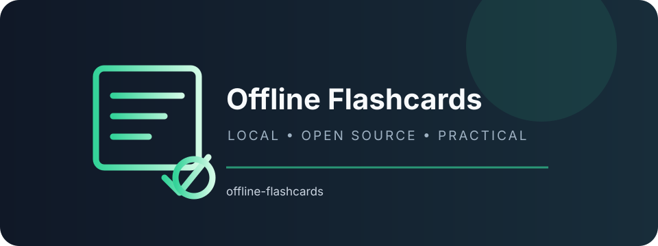

<p align="center"></p>
<p align="center"></p>
<p align="center">   </p>
<p align="center"></p>

## 🧭 Overview
Offline Flashcards is a small study tool served locally by Node.js. Cards stay in browser localStorage, and a simple Leitner schedule brings due cards back for review. There is no account, analytics, or remote database.

## ✨ Features
- 🗃️ Create, edit, and delete question/answer cards.
- 🧠 Review due cards with Again, Good, and Easy ratings.
- 📦 Import and export a portable JSON deck.
- 🔒 Stores cards only in the current browser profile.

## 🎬 Demo
```text
Create a card → review it → choose Good → it moves to the next Leitner interval.
Export your deck as JSON to keep a backup.
```
The example is local and uses no hosted backend.

## 🚀 Quick Start
```bash
npm install
npm start
```
Open http://127.0.0.1:4174. Browser storage is local to that browser; use Export JSON for backups.

## 🧰 Tech Stack
- Node.js 18+ static server
- Vanilla HTML, CSS, and JavaScript
- localStorage and Node's built-in test runner

## 🗂️ Folder Structure
```text
server.js
public/index.html
public/app.js
public/scheduler.js
public/styles.css
tests/scheduler.test.js
package.json
assets/overview.svg
```

## 🗺️ Roadmap
- [x] Core workflow
- [x] Local-first operation
- [ ] More import/export options
- [ ] Additional regression coverage

## 🤝 Contributing
Issues and focused pull requests are welcome. Add tests for behavior changes and avoid introducing unnecessary dependencies.

## 📄 License
Released under the [MIT License](LICENSE).

<p align="center"></p>
